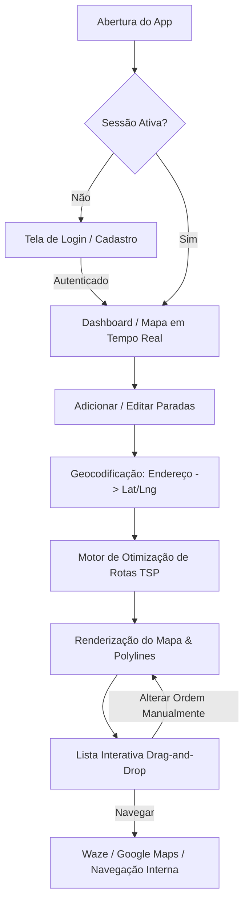
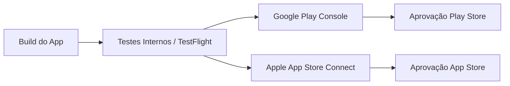

# 🚀 Roadmap Completo: Aplicativo de Otimização de Entregas (Android & iOS)

Este guia detalha todo o ciclo de vida do projeto — desde a concepção técnica e arquitetura até a publicação na **Google Play Store** e na **Apple App Store**.

---

## 1. Visão Geral e Arquitetura da Solução

O aplicativo inicia com um fluxo de autenticação seguro. Ao abrir, o app verifica se existe um token salvo: se sim, vai direto para a tela principal; se não, apresenta a tela de login/cadastro. Na tela principal, o motorista insere paradas de entrega, obtém a rota otimizada e gerencia suas entregas.



---

## 2. Escolha da Stack Tecnológica

Para publicar em ambas as lojas com um único código-fonte, a melhor escolha é um framework multiplataforma:

| Componente | Opção Recomendada: **React Native + Expo** | Alternativa: **Flutter** |
| :--- | :--- | :--- |
| **Linguagem** | TypeScript / JavaScript | Dart |
| **Por que escolher?** | Ecossistema maduro, integração com bibliotecas de mapa, e o **Expo EAS Build** permite gerar o pacote para iOS mesmo sem ter um computador Mac. | Alta performance e componentes visuais ricos prontos de fábrica. Exige Mac para compilar builds iOS localmente. |
| **Mapas & GPS** | `react-native-maps` + `expo-location` | `google_maps_flutter` + `geolocator` |
| **Lista Interativa** | `react-native-draggable-flatlist` | `ReorderableListView` |
| **Persistência Local** | SQLite (`expo-sqlite`) ou WatermelonDB | Isar ou SQLite |

> [!TIP]
> **Recomendação para agilidade:** **React Native com Expo (TypeScript)**. O serviço em nuvem **Expo EAS** economiza centenas de horas de configuração de certificados e compilação na nuvem para iOS e Android.

---

## 3. Serviços e APIs de Mapas

Você precisará de 3 recursos principais de mapa:
1. **Autocomplete de Endereço (Geocoding):** Para o motorista começar a digitar e autocompletar o endereço.
2. **Cálculo da Rota & Otimização:** O problema de ordenar do mais próximo ao mais longe considerando malha viária chama-se *Travelling Salesperson Problem (TSP)*.
3. **Renderização do Mapa:** Exibir mapa, marcadores e a linha da rota (*polyline*).

### Opções de Provedores:

| Provedor | Vantagens | Desvantagens / Custos |
| :--- | :--- | :--- |
| **Google Maps Platform** *(Places API + Directions/Routes API)* | Maior precisão de endereços no Brasil; parâmetro nativo `optimizeWaypoints: true`. | Mais caro após os $200 de crédito mensal gratuito. |
| **Mapbox** *(Navigation + Optimization API)* | Mapas esteticamente modernos, excelente documentação e API de otimização nativa. | Cota gratuita generosa, mas requer cartão cadastrado. |
| **OpenStreetMap + OSRM / Nominatim** *(Open Source)* | Gratuito ou muito barato se hospedar sua própria instância OSRM. | Menor precisão de números residenciais específicos no Brasil. |

---

## 4. Passo a Passo do Desenvolvimento (MVP)

### Etapa 1: Setup do Ambiente e Base do Projeto
1. Inicializar o projeto com Expo:
   ```bash
   npx create-expo-app@latest EntregaFacil --template tabs
   ```
2. Instalar dependências essenciais:
   - `expo-location` (GPS em tempo real)
   - `react-native-maps` (mapa vetorial)
   - `react-native-draggable-flatlist` (reordenação interativa)
   - `lucide-react-native` ou `@expo/vector-icons` (ícones modernos)

### Etapa 2: Modelagem de Dados
Definir a estrutura do usuário e de cada parada de entrega:
```typescript
interface UserProfile {
  id: string;
  name: string;
  email: string;
  vehicleType?: 'moto' | 'carro' | 'bicicleta';
}

interface DeliveryStop {
  id: string;
  orderIndex: number;
  customerName?: string;
  address: string;
  latitude: number;
  longitude: number;
  notes: string; // Ex: "Apto 402, tocar interfone 2x"
  status: 'pending' | 'delivered' | 'failed';
}
```

### Etapa 3: Autenticação & Gerenciamento de Sessão
1. **Opções de Backend de Autenticação:**
   - **Supabase Auth / Firebase Auth:** Soluções prontas com autenticação por E-mail/Senha, Google, Apple e Magic Link sem necessidade de criar backend do zero.
2. **Armazenamento Seguro do Token:**
   - Usar `expo-secure-store` para salvar o token JWT criptografado no Keychain (iOS) ou Keystore (Android).
3. **Autenticação Biométrica:**
   - `expo-local-authentication` para permitir desbloqueio rápido por Face ID ou impressão digital após o primeiro login.
4. **Proteção de Rotas:**
   - Gerenciamento de estado (Zustand ou React Context) para direcionar automaticamente o usuário entre o fluxo `(auth)` e o fluxo `(app)`.

### Etapa 4: Funcionalidades Centrais de Rotas (Core Features)

1. **Captura da Localização Inicial:** Obter `Location.getCurrentPositionAsync()` como ponto de partida da rota.
2. **Adição de Parada com Autocomplete:** Entrada de texto conectada à API de Places com campo de notas/descrição.
3. **Algoritmo de Otimização de Rota:**
   - Enviar a localização atual + lista de coordenadas para a API de rotas.
   - A API calcula a matriz de distâncias e retorna a ordem mais eficiente (menor tempo e menor trajeto).
4. **Reordenação Manual:**
   - Lista interativa com suporte a arrastar e soltar (*drag-and-drop*).
   - Quando o motorista solta um card em outra posição, os índices são recalculados e a linha do mapa é redesenhada.
5. **Edição Rápida:**
   - Ao tocar em uma parada, abre um modal/bottom sheet para editar endereço ou descrição.
6. **Integração Externa de Navegação:**
   - Botão em cada parada que abre o endereço diretamente no **Google Maps** ou **Waze** instalado no aparelho (`Linking.openURL`).

---

## 5. UI/UX: Design Amigável e Fácil de Usar

### 5.1. Tela de Login
* **Visual Limpo e Confiável:** Logo da aplicação, mensagem de boas-vindas ("Pronto para as entregas de hoje?").
* **Inputs Amigáveis:** Teclado numérico/email formatado automaticamente, botão "mostrar senha" com ícone de olho.
* **Acesso Rápido:** Botão de login com biometria (Face ID / Digital) destacado se já houve login anterior.
* **Login Social Integrado:** "Entrar com Google" e "Entrar com Apple".
* **Recuperação de Senha & Cadastro:** Links diretos e visíveis sem poluição visual.

### 5.2. Tela Principal do Motorista
Para motoristas de entrega, a usabilidade precisa focar em **velocidade, botões grandes e legibilidade sob sol**:

* **Layout Dividido:** 
  - Metade superior: Mapa limpo com pinos numerados (1, 2, 3...) e a linha da rota.
  - Metade inferior: Lista retrátil (*Bottom Sheet*) com as entregas.
* **Ações com 1 Toque:**
  - Botão verde destacado: *"Navegar para a próxima"*
  - Botão de check: *"Marcar como Entregue"*
* **Modo Escuro / Claro automático:** Conforto visual à noite.
* **Feedback Tátil (Haptics):** Pequena vibração ao arrastar e soltar itens da lista.

---

## 6. Preparação e Publicação nas Lojas

A publicação nas lojas oficiais exige cumprimento de regras rigorosas, principalmente quanto a **GPS em tempo real** e **Autenticação**:



### 6.1. Requisitos Críticos de Autenticação nas Lojas

> [!IMPORTANT]
> **Atenção às regras estritas da Apple e Google para não ter o app reprovado:**
> 1. **Sign in with Apple obrigatório:** Pela [Diretriz 4.8 da Apple](https://developer.apple.com/app-store/review/guidelines/#design), se o app oferecer login por terceiros (ex: Google ou Facebook), **é obrigatório** oferecer também "Entrar com Apple". Se usar apenas E-mail/Senha próprio, o Apple Sign-in é opcional.
> 2. **Exclusão de Conta Obrigatória (Account Deletion):** Se o usuário pode criar uma conta pelo app, as diretrizes da Apple e Google exigem um botão claro nas configurações para ele **excluir permanentemente sua conta e dados**.
> 3. **Credenciais para os Revisores:** Você precisará fornecer um login e senha de teste totalmente funcionais no painel da Apple e da Google para que eles possam testar o app logado.

### 6.2. Google Play Store (Android)

1. **Conta de Desenvolvedor:**
   - Registro no [Google Play Console](https://play.google.com/console). Taxa única de **$25 USD**.
   - Verificação de identidade com documento e endereço.
2. **Requisitos Críticos:**
   - **Teste Fechado Obrigatório:** Contas pessoais novas precisam passar por um teste fechado com **20 testadores por 14 dias contínuos** antes de solicitar acesso à produção.
   - **Declaração de Localização:** Justificar por que o app usa GPS.
   - **Política de Privacidade:** Link público contendo a política de tratamento de dados.
3. **Geração da Build:**
   - Compilar arquivo `.aab` (Android App Bundle) via `eas build --platform android`.
4. **Envio e Revisão:**
   - Preencher questionário de classificação de conteúdo, screenshots do app e credenciais de login de teste.

### 6.3. Apple App Store (iOS)

1. **Conta Apple Developer Program:**
   - Registro no [Apple Developer](https://developer.apple.com/). Anuidade de **$99 USD/ano**.
2. **Requisitos Críticos:**
   - **Permissões no Info.plist:** Textos claros explicando a necessidade de localização.
   - **Design Human Interface Guidelines (HIG):** A Apple rejeita apps que parecem "sites envelopados".
   - **Conta de Teste:** Fornecer usuário e senha nos dados de contato da App Store Connect.
3. **Geração da Build:**
   - Compilar pacote `.ipa` via `eas build --platform ios`.
4. **Distribuição via TestFlight:**
   - Testar em aparelhos iOS reais via TestFlight antes do lançamento público.
5. **Envio para Avaliação (App Review):**
   - Preencher dados, capturas de tela para iPhone e iPad, e submeter.

---

## 7. Estimativa de Prazos e Custos

| Item | Prazo Médio | Custo Estimado |
| :--- | :--- | :--- |
| **Design & Prototipagem** | 1 semana | R$ 0 (se feito por você) |
| **Desenvolvimento do MVP** | 3 a 5 semanas | Custo de desenvolvimento |
| **Conta Google Play** | Imediato | $25 USD (taxa única) |
| **Conta Apple Developer** | 1 a 2 dias (aprovação) | $99 USD/ano |
| **APIs de Mapa (Google/Mapbox)** | Durante uso | Gratuito na cota inicial (Google dá $200/mês) |
| **Aprovação nas Lojas** | 2 a 3 semanas (incluindo testes de 14 dias do Google) | - |

---

## 8. Próximos Passos Sugeridos

1. **Definição da Stack:** Confirmar se avançamos com **React Native + Expo** ou **Flutter**.
2. **Definição do Provedor de Mapas:** Escolher entre Google Maps Platform ou Mapbox.
3. **Criação da Interface Inicial:** Montar o primeiro protótipo interativo da tela de login e da tela de mapa com a lista de paradas.
